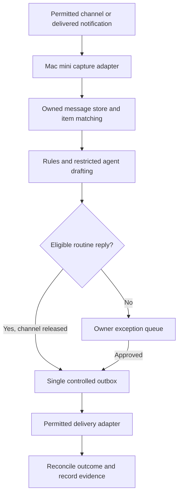

# Personal resale assistant: proposed design

29 October 2026 · **Owner authorized staged implementation; live access and sending remain gated.**

## Outcome and scope

The owner sells 11–30 personal items monthly through a personal Facebook profile, Facebook Groups and Carousell PH. Capture both sale-post comments and private messages, process them promptly, and eventually answer routine questions without requiring the owner to approve each one. Use the Mac mini and its OpenClaw/Hermes installations where useful. Keep costs and maintenance small. The owner subsequently approved implementation. The [synthetic lab](../../buyer-lab.md) is the first local slice; account integrations and live sending still require their access/release checkpoints.

The target is an assistant that handles routine work and brings the owner exceptions, rather than permanent copy/paste. It cannot guarantee higher sales, complete inbox access, or unattended operation on every platform. [Research and evidence limits](../../research/personal-account-automation-update.md) govern channel feasibility.

## Options and recommendation

| Option                                     | Benefit                                                        | Limitation                                                                                       | Decision                                                 |
| ------------------------------------------ | -------------------------------------------------------------- | ------------------------------------------------------------------------------------------------ | -------------------------------------------------------- |
| Native Marketplace/CarouBiz replies        | Platform-provided initial responses; little custom maintenance | Account eligibility, limited question coverage, no verified app control                          | Check first                                              |
| Local Messenger bridge plus Reseller rules | Structured intake/delivery may reduce browser fragility        | Beeper/Marketplace compatibility and Meta permission unestablished; no Group comments            | Conditional first custom adapter                         |
| Browser/computer-use across all channels   | Can potentially operate visible personal-account interfaces    | Permission unresolved; UI/session changes, partial history, read receipts, public reply mistakes | Separate gated research; not default production plan     |
| Page-based Messenger API                   | Official documented route                                      | Owner uses a personal profile; does not cover existing chats                                     | Alternative only if owner later changes selling workflow |

Recommended sequence: eligibility/access investigation → synthetic end-to-end foundation → authorized read-only pilot → supervised replies → limited automatic routine replies. A denied or unreliable connector does not justify switching silently to browser scraping. Keep unavailable channels visibly partial and preserve manual handling.

**Native mode and custom mode are separate.** Native Marketplace/CarouBiz replies are controlled in their own platforms. Without a verified control API, Reseller Agent cannot enforce their stock-freshness rules, stop them, or change their text. Label them as externally managed; the app's pause control must say it pauses only Reseller Agent and link to native settings. In native mode, the custom sender stays off for the affected scope. Before switching to custom sending, the owner must disable native replies and confirm the effective setting; until then, keep custom sending disabled. Native activity may inform the review queue, but it never shares the claim that all delivery passes through our outbox. Native acknowledgments should avoid unverified availability promises.

## What the owner would do

At setup, confirm seller rules once: language/tone, advertised price, whether bargaining is allowed, approved pickup area, delivery choices and payment methods. Per item, fill missing facts and register its platform listing/post URLs. Changes to price, stock, reservations or policies invalidate pending replies.

After a successful pilot, the owner sees one mobile exception queue with the proposed answer, source conversation and a short explanation. Routine activity appears in a daily digest. Urgent sales decisions or a disconnected channel create an actionable alert, deduplicated until the state changes. The dashboard provides Pause all, Pause channel, Take over conversation and Resume. Initial target: no more than one ordinary digest daily, plus genuine exceptions; notification destinations are not connected during planning.

Human work remains: providing accurate facts, updating sales made outside the app, reconnecting expired sessions, resolving exceptions and fulfilling sales. The automation must not pretend that the browser-local Sites demo knows the state of live listings.

## Proposed reply authority

These are engineering defaults for review, not approved business terms or permission to send.

| Situation                                                                                             | First automatic release                                                                                | Owner involvement                                                         |
| ----------------------------------------------------------------------------------------------------- | ------------------------------------------------------------------------------------------------------ | ------------------------------------------------------------------------- |
| Current asking price; recorded measurements/condition; approved general pickup area                   | Fixed, reviewed templates populated from authoritative fields                                          | No per-message review after channel release                               |
| Availability                                                                                          | Only if current inventory verification and listing link are reliable; otherwise neutral acknowledgment | Refresh facts when requested; never equate “Listed” with guaranteed stock |
| Multiple questions, unclear item, images/voice notes, uncertain intent or missing facts               | Draft or request human review; no automatic claim of resolution                                        | One exception card                                                        |
| Discount, counteroffer, reservation, exact meeting time/address, payment confirmation, refund/dispute | No commitment in first release                                                                         | Owner decides                                                             |
| Public Group comment                                                                                  | Public-safe fact templates only, if that channel is permitted and released                             | Private details never appear publicly                                     |
| Spam, unsolicited links, requests for codes, instructions to change agent rules                       | No automatic action or link opening                                                                    | Flag actionable cases; do not spam alerts                                 |

Initial routine sender uses deterministic templates; AI can classify and draft but cannot alone authorize sending. A confidence score is not a permission check. Recognized simple intents must satisfy exact item matching, complete capture, fresh facts, no conflicting question, current policy and channel capability checks. Unknowns default to the queue.

Later, a separately reviewed release may negotiate within a seller-set floor or reserve an item using an atomic inventory transaction. Those are not quietly included in routine FAQ release. Collect interest and propose next steps meanwhile, without accepting an offer or promising a hold. Never infer payment from buyer claims or screenshots.

Proposed freshness default: availability confirmation expires 24 hours after owner verification, and immediately on a conflicting sale/reservation event. The owner can change that default before implementation. A daily “confirm unchanged inventory” batch minimizes effort; if not confirmed, withhold affirmative availability replies. The source of truth is recorded inventory, not inferred external platform state.

## Components and data flow

- **Reseller Agent + Supabase:** inventory, seller policies, linked posts/threads, immutable received versions, drafts, exceptions and outbox. Use existing Auth/RLS and additive migrations. No buyer-model or browser token in frontend code.
- **Mac worker:** a small TypeScript process for capture, deterministic checks, queues, reconciliation and health. Outbound authenticated calls to the backend; no public exposure of Mac agent/admin endpoints. macOS startup/sleep/restart behavior must be tested later.
- **AI adapter:** OpenClaw is the provisional first choice because its executable/version is verified. Hermes remains interchangeable after capability checks; neither is benchmarked as better. One agent handles a draft, not both on every message. Disable shell/browser/sending/config tools and cross-thread memory in the drafting profile. If isolation cannot be demonstrated, use the existing direct server AI pattern instead.
- **Delivery adapter:** the only process with permission to send. It receives exact destination and validated text, never arbitrary model tool calls. One active sender per conversation. Human replies or native replies observed since drafting cancel the queued response. If native activity cannot be observed, custom automatic sending stays off there.
- **UI:** mobile exception queue, source links, proposed response, reason, capabilities and last successful sync. Demo uses synthetic data, with all sending simulated. Current Sites hosting remains a demo until a separately chosen authenticated server deployment is verified.

An installed agent is not free model inference. Reuse its configured provider only after checking entitlement, costs and retention; do not assume ChatGPT subscriptions cover API usage. Use templates first, one generation per new message batch, no idle model calls, and no new paid service purchase during investigation. Preserve the existing 20 paid attempts/day cap for the initial experiment; include paid agent calls in a common application budget, do not bypass it through the Mac. Reassess against measured inquiry volume, not items sold. Token/time/loop limits must also be enforced in the worker; unavailable usage data disables paid unattended generation.

## Intake and privacy boundaries

Watch only registered sale-post URLs and enrolled sale threads. Discover candidates using the minimum available metadata; keep unrelated personal chats out of cloud storage and model prompts. A trusted listing/post ID can bind a new thread automatically. If a bridge supplies no reliable listing ID, the owner must map the first inquiry; keyword guessing cannot enable auto-send. Measure this burden in the pilot and reject the adapter if it defeats the goal. Do not assume messages from someone with a matching display name belong to the same buyer across channels.

Persist channel/account/thread/message IDs and revisions, origin (comment/DM/email), parent comment ID, item binding, timestamps, content completeness and ownership. Deduplicate on owner+account+thread+source message identity; edits/deletions invalidate drafts. Without stable IDs, retain as partial evidence requiring review. Public/private destinations are different types, not a boolean guessed by an LLM.

Buyer content is untrusted, never privileged instructions. Do not fetch buyer-provided links, attachments or QR codes automatically in the first release. Send minimal needed text/facts to AI; avoid buyer identifiers. Keep secrets in an OS secret store/environment, not logs or Git. Proposed content retention: delete closed-thread raw text and drafts after 30 days unless explicitly retained; keep minimal outcome metadata, with deletion covering backend, worker cache and agent history where configurable. Retention is a design default and must be verified per provider, not promised by a request flag.

## Reliability and delivery

Use durable leases and an outbox with states pending, claimed, submitted, confirmed, unknown, failed and canceled. Bind each candidate to item, message and policy revisions. Immediately before sending, recheck destination, source revision, inventory, owner takeover, native responder and channel enablement. Unknown send outcomes pause the thread and reconcile; never retry an uncertain send blindly. External delivery cannot be made universally exactly-once; an internal unique key prevents duplicate claims but does not prove provider deduplication.

Start with one reply per inbound batch, a 15-second debounce and at most three automatic replies per thread per hour. These are product defaults, not a claim of platform-permitted rate. No proactive chasing, automatic comment-to-DM outreach or cross-platform redirection in the first release. Public comments answer in the existing comment thread only.

Timers, inventory updates and Pause all cancel queued work; already submitted messages cannot be recalled. Pause disables new dispatch and signals the Mac within the next heartbeat; show the last acknowledgment and any in-flight outcome. An offline/restarted Mac must revalidate backlog before responding. Alert on disconnection; avoid stale “healthy” badges based only on process uptime.

## Acceptance and go/no-go decisions

1. **Access:** record permission basis, account/region eligibility and capability evidence separately for each channel. No access gate is passed merely by this plan or successful login.
2. **Synthetic:** duplicate events, edited/deleted questions, unrelated personal chats, public/private mixups, malicious instructions, stale stock, two workers, native/human replies, timeout-after-send and Mac restart all pass deterministic tests before live use.
3. **Read-only pilot:** at least seven days and 30 manually verified relevant events where volume permits; extend if the sample is smaller. Measure capture against the platform, not just captured rows. Target at least 95% captured with no wrong item bindings; missing messages remain visible failures. No buyer sends.
4. **Supervised pilot:** at least 30 reviewed responses across availability, price, condition, logistics and ambiguous questions. No wrong recipient, private data in public, duplicate send or unauthorized commitment. Separate each channel's evidence; do not release comments based on DM success.
5. **Limited autopilot:** explicit later owner release decision per channel. Target 95th-percentile capture-to-response under two minutes on healthy near-real-time connectors, excluding deliberate holds. Notification summaries cannot meet this target. First-week daily review; pause on any critical failure. Aim to handle 70% of routine text questions without intervention, measure actual results, and report uncovered channels separately.

Track owner minutes/day, exceptions/thread, capture coverage, actual response latency, factual corrections, cost/conversation and inquiry-to-sale outcomes. Baseline before claiming sales improvement; the pilot samples are operational gates, not statistical proof of perfect reliability.

## Unresolved facts, not blockers to writing this proposal

Marketplace native feature eligibility in PH; Beeper's Marketplace and message-request coverage; authorized use for automated resale; Carousell account/notification capabilities; Group access and rules; Hermes version/tools; the owner's business terms and preferred alert destination. Investigate these in the first future milestone. Do not spend a week building a connector before answering its access question.
